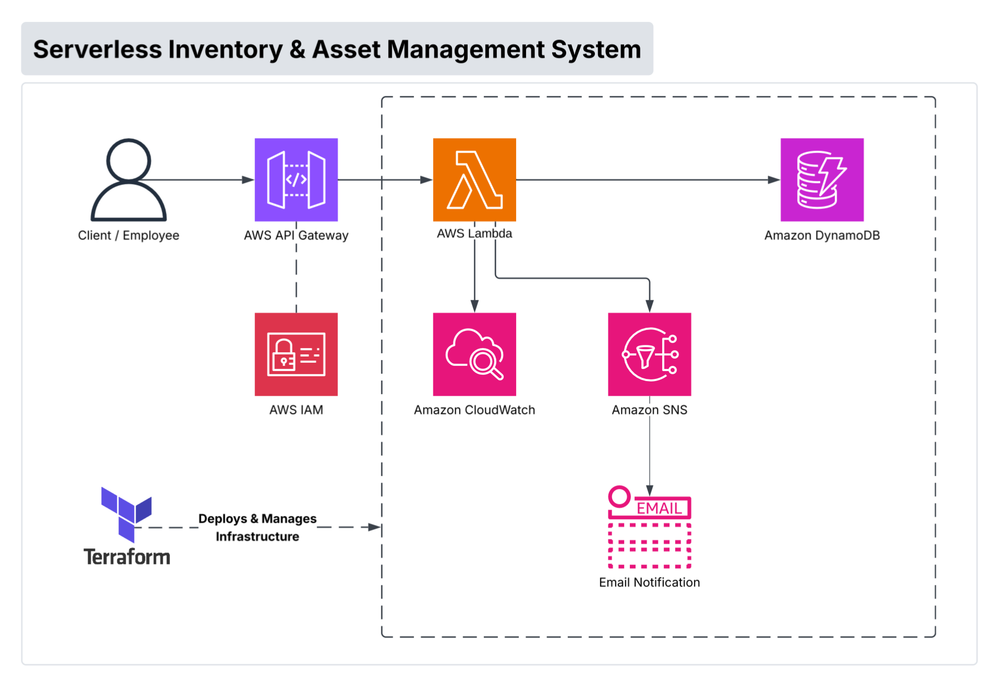
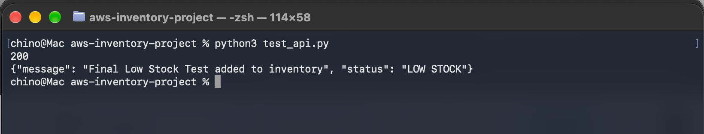
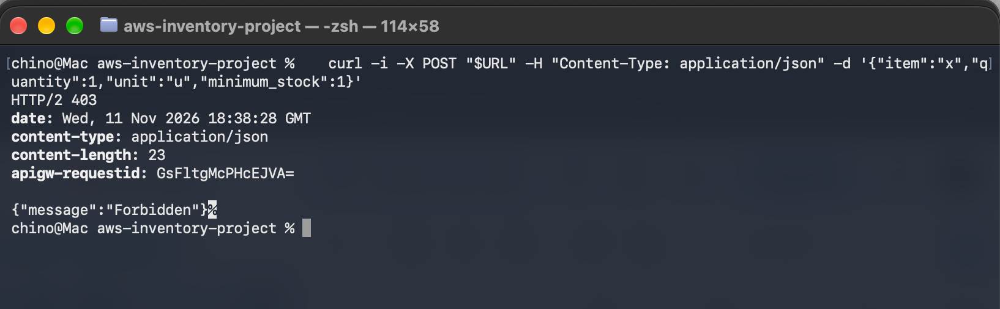
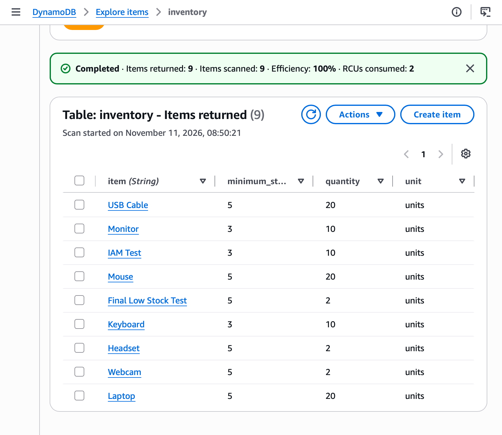
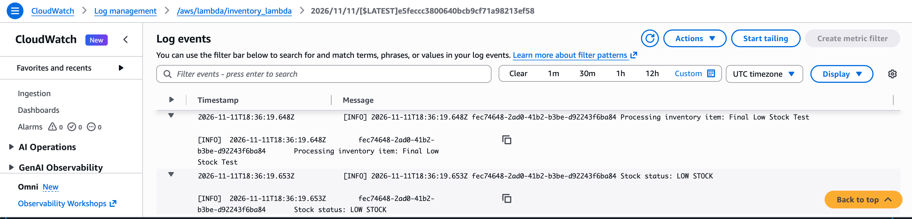
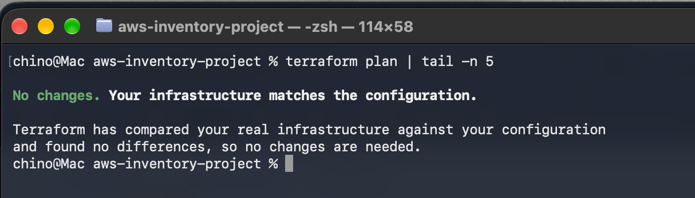

# AWS Serverless Inventory System

A cloud-based API for tracking inventory, built on AWS and deployed with Terraform.

**The problem:** Tracking supplies with pen and paper is slow, easy to get wrong, and nobody notices when stock runs low until it's gone.

**The solution:** Send an item's quantity to the API and it is saved in a database automatically. If stock is at or below the minimum you set, the system emails an alert right away. Since it's serverless, there are no servers to manage, and you only pay when it's used.

> **Status:** Inventory tracking is working today. Full asset management (checkout history, read/update/delete) is on the roadmap below.
>
> **Built with AI assistance:** This is a learning project. I used AI guidance while building it, and I deployed, debugged, and tested it myself.

## Architecture



```
Client -> API Gateway (IAM auth) -> Lambda -> DynamoDB
                                       |
                                       v
                                      SNS -> Email
```

Terraform deploys and manages the infrastructure. CloudWatch collects Lambda logs for troubleshooting.

## AWS Services

- Amazon API Gateway (HTTP API)
- AWS Lambda (Python 3.13)
- Amazon DynamoDB
- Amazon SNS
- Amazon CloudWatch
- AWS IAM

## How It Works

1. A client sends a signed `POST /inventory` request with an item, quantity, unit, and minimum stock.
2. API Gateway checks the request's IAM authorization (SigV4 signature).
3. Lambda validates the data.
4. Lambda saves the record in DynamoDB.
5. If the quantity is at or below the minimum, Lambda publishes a message to SNS.
6. SNS sends an email alert.
7. CloudWatch records Lambda activity.

### Example

Request body:

```json
{
  "item": "Printer paper",
  "quantity": 2,
  "unit": "reams",
  "minimum_stock": 5
}
```

Response (`200 OK`):

```json
{
  "message": "Printer paper added to inventory",
  "status": "LOW STOCK"
}
```

Email alert:

```
Subject: Low stock alert: Printer paper

Printer paper is low on stock. Current quantity: 2 reams. Minimum stock: 5.
```

Invalid requests (missing fields or negative numbers) return a `400` error with a short message.

## Infrastructure (Terraform)

`main.tf` defines:

- DynamoDB table (`inventory`, pay-per-request)
- Lambda function and its IAM role and policies
- SNS topic for low-stock alerts
- API Gateway HTTP API, route, and stage with IAM authorization
- Lambda permission for API Gateway

**Manual step:** The SNS email subscription was created by hand in the AWS console and is not yet managed by Terraform. Moving it into Terraform is on the roadmap.

## Getting Started

Requirements: an AWS account, AWS CLI credentials configured, Terraform, and Python 3.

```bash
terraform init
terraform plan
terraform apply
```

Then subscribe your email to the `inventory-low-stock` SNS topic and confirm the subscription.

To test the API:

```bash
pip install boto3 requests requests-aws4auth
python test_api.py
```

Update the `url` in `test_api.py` with the `api_url` output from Terraform.

## Testing

Scenarios I tested:

- Valid authenticated submission (200)
- Unsigned request (403 Forbidden)
- Missing required field (400)
- Negative quantity (400)
- Stock above the minimum (status: STOCK OK)
- Stock at or below the minimum (status: LOW STOCK, email received)
- Lambda logs in CloudWatch

## Proof It Works

**Authorized request: 200 OK with a LOW STOCK status**



**Unsigned request: 403 Forbidden**



**Records saved in DynamoDB** (the rows are test data)



**Lambda logs in CloudWatch**



**Low-stock email alert from SNS**


**`terraform plan`: the live infrastructure matches the code**



## Design Decisions

- **Serverless (Lambda + API Gateway):** No servers to patch or keep running, and nothing is billed while idle.
- **HTTP API instead of REST API:** Simpler and cheaper, and it has everything this project needs.
- **DynamoDB (on-demand):** Inventory traffic is small and unpredictable, so there's no capacity to plan or pay for in advance.
- **IAM authorization:** Built into API Gateway, so no extra auth service is needed. It fits programs calling the API. Staff logins would need Cognito or SSO (see next steps).
- **SNS for alerts:** Sends email without running a mail server, and can fan out to other channels later.
- **Terraform:** Repeatable, reviewable infrastructure that can be rebuilt or torn down with one command.

## Cost

Everything is pay-per-use, so at low volume the cost is close to nothing. There are no always-on resources (no servers, load balancers, or NAT gateways).

## Security

- All API requests require AWS IAM authorization. Unsigned requests return 403.
- The Lambda role is scoped to the specific DynamoDB table and SNS topic, not `*`.
- Input is validated before it reaches the database.
- Terraform state, `.terraform/`, and build artifacts are excluded by `.gitignore`.

## Project Structure

```
.
├── main.tf               # Terraform infrastructure
├── lambda_function.py    # Lambda application logic
├── test_api.py           # Sends a signed test request to the API
├── architecture.png      # Architecture diagram
├── *.png                 # Test and deployment screenshots
├── .terraform.lock.hcl   # Provider version lock
├── .gitignore
└── README.md
```

## Known Limitations and Next Steps

- **Write-only API.** Only `POST /inventory` exists. Add read, update, and delete endpoints.
- **No history.** Submitting an existing item overwrites it. Add timestamps and an audit trail.
- **Authentication is built for programs.** IAM auth suits services, not staff logins. Cognito or SSO would be the next step.
- **Alert frequency.** An email is sent on every low-stock submission, not just when stock first crosses the minimum.
- **Input validation.** Malformed JSON or non-numeric values should return a clean 400 error.
- **Least privilege.** Trim Lambda's DynamoDB permissions to only what the code uses.
- **Monitoring and recovery.** Add CloudWatch alarms, log retention, and DynamoDB point-in-time recovery.
- **Terraform gaps.** Manage the SNS email subscription in Terraform and move the table name into an environment variable.

## Cleanup

To remove the AWS resources created by Terraform:

```bash
terraform destroy
```

Review the plan before confirming.

## What I Learned

- Connecting serverless AWS services into one working system
- Managing infrastructure with Terraform
- Controlling access with IAM and request signing (SigV4)
- Troubleshooting expired credentials, stale code, and missing logs
- Testing both successful and unauthorized requests
